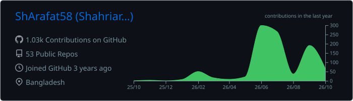
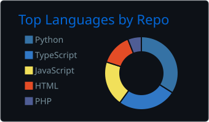
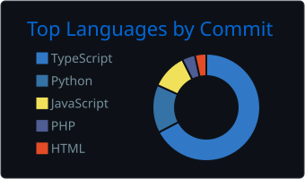
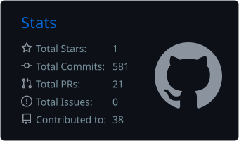
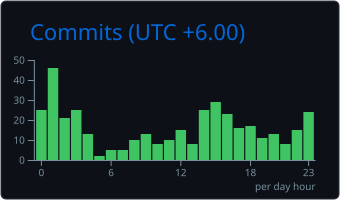

<!-- ============ HEADER ============ -->
<p align="center">
  
</p>

<p align="center">
  <a href="https://git.io/typing-svg">
    
  </a>
</p>

<p align="center">
  <a href="https://www.linkedin.com/in/shahriar-hossain-arafat/"></a>
  <a href="https://shahriar-arafat.netlify.app/"></a>
  <a href="https://shahriar-arafat-security.netlify.app/"></a>
  <a href="https://tryhackme.com/p/ShahriarHArafat"></a>
  <a href="https://ieeexplore.ieee.org/document/11491250"></a>
  <a href="mailto:shahriararafat20@gmail.com"></a>
</p>

<p align="center">
  
  
  
</p>

---

## 👋 About Me

```yaml
name:      Shahriar Hossain Arafat
education: B.Sc. in CSE, Ahsanullah University of Science and Technology (2022 - 2026)
track_1:   Full Stack Developer   -> AI integrated web apps in React, Next.js, TypeScript, PostgreSQL
track_2:   Cybersecurity Analyst  -> Blue team, Wazuh SIEM, log analysis, detection engineering
research:  1 IEEE publication (ICCIT 2025)
currently: Shipping AI powered products and hunting flags on TryHackMe
```

I work on two tracks. On the **development** side I build real time, authentication driven web applications
with LLM APIs wired directly into the product. On the **security** side I monitor, detect, and write defensive
tooling from a hands on SOC internship. Pick the track you are hiring for below.

<table align="center">
  <tr>
    <td align="center" width="50%"><a href="#-track-1--full-stack-development"><b>💻 Full Stack Development</b></a><br/><sub>React · Next.js · TypeScript · Node.js · PostgreSQL · Claude & Gemini API</sub></td>
    <td align="center" width="50%"><a href="#%EF%B8%8F-track-2--cybersecurity"><b>🛡️ Cybersecurity</b></a><br/><sub>Wazuh SIEM · Log Analysis · Detection Rules · Phishing Defense · CTFs</sub></td>
  </tr>
</table>

---

# 💻 Track 1 · Full Stack Development

### 🛠️ Dev Stack

**Languages**


**Frontend**


**Backend and Databases**


**Tools and Platforms**


**Generative AI**


### 💼 Experience

**Commercial Software Development Trainee (JavaScript)** · Itransition · Remote, Georgia · `Jun 2026 - Aug 2026`

- Built a full stack user management platform with registration, login, JWT authentication, and a role controlled admin panel on React, Express, and PostgreSQL.
- Shipped a real time multiplayer Battleship game on React, Node.js, Socket.IO, and PostgreSQL with live remote play, custom game setup, a lobby system, and a persistent leaderboard.
- Delivered a full stack CV management system where recruiters define job positions and candidates auto generate tailored CVs from stored profile data.
- Created a deterministic fake music store generator that reproduces songs, album covers, and playable audio from a single seed (React, Express, TypeScript).
- Deployed an HTTP service computing least common multiple over arbitrary precision inputs with BigInt and strict request validation, plus a Node.js pipeline that hashes 256 binary files with SHA3-256, sorts them by a computed key, and folds the result into one combined hash.
- Solved algorithmic tasks under byte count limits, including a minimal bytes JavaScript code golf solution for the longest common substring.

### 🚀 Featured Dev Projects

| Project | Stack | What It Does |
|---|---|---|
| **[🛒 SocialSeller](https://github.com/ShArafat58/SocialSeller)** | Next.js · Supabase · Claude API | AI social commerce dashboard for Bangladeshi Facebook and WhatsApp sellers covering orders, inventory, and shipping, with Claude generated bilingual product posts and customer replies over REST endpoints. |
| **[📄 CV Management System](https://github.com/ShArafat58?tab=repositories)** | React · Express · TypeScript · Prisma · PostgreSQL | Recruiters build customizable position templates and candidates generate tailored CVs from their stored profile. |
| **[🚢 Battleship](https://github.com/ShArafat58?tab=repositories)** `Real Time` | React · Express · Socket.IO · TypeScript | Two player remote multiplayer game. Create or join sessions with custom grid sizes and ship configurations. |
| **[🧠 NeuroQuest](https://neuroquestweb.netlify.app/)** `Live` `🏅 Finalist` | Next.js · Supabase · Gemini API | Bilingual adaptive learning platform for SSC, HSC, IELTS, and Medical students with diagnostic tests, personalized study paths, and spaced revision. |
| **[🔍 ShottoQR](https://github.com/ShArafat58?tab=repositories)** `🏆 Champion` | React · Supabase · AI | Forensic image verification and justice tracking platform. Won the Spirit of July track at July Hackathon 2026. |

<details>
<summary><b>More shipped builds</b></summary>
<br/>

| Project | Stack | What It Does |
|---|---|---|
| **[🌾 FarmHelper](https://farmhelper-ai.lovable.app/)** `Live` | React · Tailwind · Supabase · AI | Mobile first bilingual farming companion with image based crop diagnosis, region aware profit planning, and a farmer to buyer marketplace secured with row level security. |
| **[🏗️ PermitPilot](https://permitpilot-app.lovable.app/)** `Live` | React · TypeScript · Supabase | Compliance tracker for construction contractors with a one click AI risk scan that scores projects 0 to 100 and flags slipping deadlines. |

</details>

### 🏆 Dev Achievements

- 🥇 **Champion**, Spirit of July track, July Hackathon 2026, for ShottoQR
- 🏅 **Team Finalist (Top 100 teams)**, THE INFINITY AI BUILDFEST 2026 (CloudCamp Bangladesh and BRAC University), for NeuroQuest
- 🚀 **Top 100 Finalist (Individual)**, Vibe Coding to Production Challenge, THE INFINITY AI BUILDFEST 2026
- 📈 **Globally Ranked 85 (top 5%)**, HackerRank Hackathon, August 2026 edition

### 📜 Dev Certifications

- Frontend Developer (React), **HackerRank**
- Full Stack Developer, **micro1**
- Certified AI Foundations Associate, **Oracle** <sub>valid through Feb 2028</sub>

---

# 🛡️ Track 2 · Cybersecurity

### 🛠️ Security Stack


| Area | Skills |
|---|---|
| **Security Operations** | SIEM Monitoring (Wazuh), Log Analysis, Threat Detection, Detection Rule Writing, Incident Response, Brute Force Detection, Windows Event Log and Linux Syslog Analysis, PowerShell Activity Monitoring, Incident Reporting |
| **Security Domains** | Phishing Detection and Analysis, Identity and Access Management, Vulnerability Assessment (SQLi and API testing), Network Security, VLAN Segmentation, Cryptography, Steganography, Secure Coding |
| **Tools** | Wazuh, Wireshark, TCP/IP, Port Scanning, PyQt5, Chrome Manifest V3, TryHackMe |

### 💼 Experience

**SOC Analyst Intern** · Tech Hierarchy · Remote, Pakistan · `Mar 2026`

- Deployed and configured a SIEM platform in a lab, onboarded Windows Event Log and Linux Syslog sources, generated sample telemetry, and verified events were parsed and indexed end to end.
- Wrote and tested custom SIEM alert rules, validating each one against simulated attack traffic to confirm it fired and to tune out noisy false positives.
- Detected simulated brute force logins by building authentication log filters and correlating repeated failed logons against source hosts and accounts.
- Monitored suspicious PowerShell execution, traced command line arguments and parent processes, and wrote up findings as incident reports.
- Designed a segmented VLAN topology separating user, server, and management traffic to limit lateral movement.
- Produced an attack analysis of the Bangladesh Bank cyber heist, mapping the intrusion chain from initial access to SWIFT message manipulation and the detective controls that would have caught it earlier.

### 🔐 Security Tooling

| Project | Stack | What It Does |
|---|---|---|
| **[🎣 PhishGuard](https://github.com/ShArafat58?tab=repositories)** | TypeScript · Chrome Manifest V3 | Real time anti phishing extension that scores every visited URL against a heuristic ruleset and inspects live DOM structure to flag credential harvesting pages before anything is submitted. Warns inline with a reason instead of blocking silently. |
| **[🕵️ Top-Secret](https://github.com/ShArafat58/Top-Secret)** | Python · PyQt5 · Pillow · Cryptography | Desktop steganography app that hides text or images inside cover images with LSB embedding, encrypting the payload first so it stays unreadable even if the carrier is recovered. |
| **[🔑 Password Manager](https://github.com/ShArafat58?tab=repositories)** | Python · Cryptography | Local credential vault that keeps every secret encrypted on disk behind one master password, with nothing in plaintext at rest. |
| **[📡 Port Scanner](https://github.com/ShArafat58?tab=repositories)** | Python · Sockets | TCP scanner that sweeps a user defined port range and reports each port as open, closed, or timed out. |

### 🚩 Security Achievements

- 🛡️ **Top 4% globally on TryHackMe**, 100+ hands on labs
- 🚩 **Finalist**, Cybernauts CTF, North South University: 19th of 267 teams, the only qualifying team from AUST
- 🎯 **Finalist**, CTF at SMUCT CSE Fest v3.0: 1st in the preliminary round, 7th in the final
- ⚑ **163rd**, TechnoNext Software Ltd CTF online round, solved 7 of 12 challenges
- 📊 **84.7% overall**, Cyber Security and Ethical Hacking Career Track, Ostad

### 📜 Security Certifications

- Cyber Security and Ethical Hacking Career Track Program, **Ostad**
- Cybersecurity Analyst Job Simulation (IAM), **Forage x TATA**
- Advent of Cyber 2025, **TryHackMe**
- Pre Security Learning Path, **TryHackMe**

---

## 📄 Research and Publications

> **LeafVRNet: An Explainable Feature Fusion Framework for Plant Leaf Disease Detection**
> 28th International Conference on Computer and Information Technology (ICCIT 2025), IEEE
> [📖 Read the paper](https://ieeexplore.ieee.org/document/11491250)

---

## 🎓 Education and Leadership

| Years | Degree | Institution |
|---|---|---|
| 2022 - 2026 | B.Sc. in Computer Science and Engineering | Ahsanullah University of Science and Technology |
| 2018 - 2020 | Higher Secondary Certificate | Dhaka College |
| 2018 | Secondary School Certificate | Ideal School and College |

- **Class Representative**, CSE, AUST: liaison between faculty and students, coordinating schedules and resolving academic concerns.
- Organized **CSE Fest, CSE Carnival**, and inter department sports events, managing logistics and volunteer teams.

---

## 📊 GitHub Stats

<!-- Generated in-repo by .github/workflows/profile-cards.yml (no public API, no rate limits) -->

<p align="center">
  
</p>

<p align="center">
  
  
</p>

<p align="center">
  
  
</p>

---

<p align="center">
  <b>Open to full stack, frontend, and cybersecurity trainee roles.</b><br/>
  <a href="mailto:shahriararafat20@gmail.com"></a>
  <a href="https://shahriar-arafat.netlify.app/"></a>
  <a href="https://shahriar-arafat-security.netlify.app/"></a>
  <a href="https://www.linkedin.com/in/shahriar-hossain-arafat/"></a>
</p>

<p align="center">
  
</p>
